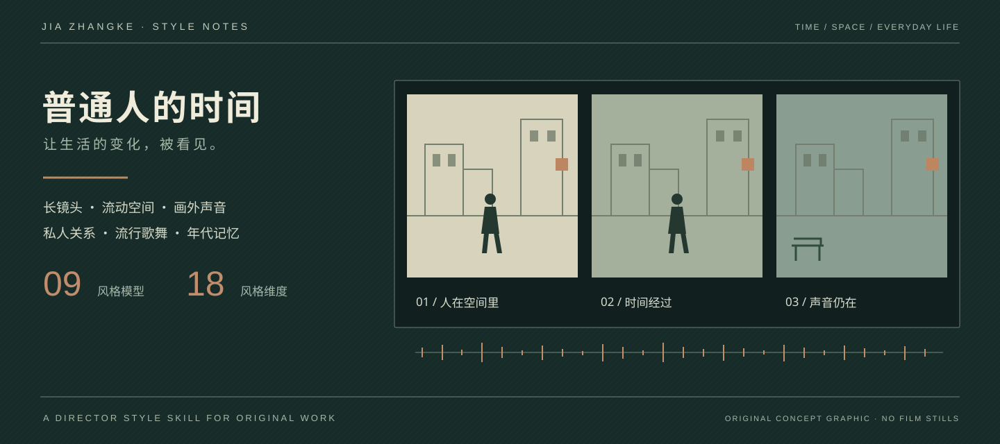

<div align="center">

# 贾樟柯 Skill



**让普通人的时间，留下来。**

[](LICENSE)
[](#九个核心风格)
[](#从作品看差异)
[](jia-zhangke-skill/references/style-atlas.md)

**人物与时代 · 县城与流动 · 长镜头 · 画外声 · 流行歌舞 · 年代省略 · 媒介记忆**

把公开作品与创作谈中的导演方法，整理成可调用的风格模型、影像 DNA 和原创创作技能。

[九个核心风格](#九个核心风格) · [影像 DNA](#影像-dna) · [镜头怎样切换](#镜头怎样切换) · [原创微例](#原创微例一次离开怎样被看见) · [安装与调用](#安装与调用) · [图片案例《最后一卷》](#last-roll-example)

</div>

---

## 导演底色

**贾樟柯的辨识度，在于他怎样把一个人的生活，与正在变化的时代放在一起。**

人物在找工作、见朋友、寻找亲人、离开故乡。建筑与交通变了，赚钱和联系的方式变了，关系也随之改变。镜头保留身体、等待和日常动作；广播、流行歌与环境声让画外世界进入生活。

这份技能记录这些具体的观看与表达方式，再将它们转成剧本、镜头、声音和剪辑选择。下面的模型名称为本项目的分析归纳，具体依据见[来源](jia-zhangke-skill/references/sources.md)。

## 九个核心风格

| 风格模型 | 特点是什么 | 怎样出现在影像里 |
| --- | --- | --- |
| **私人关系写出时代** | 社会变化穿过友谊、爱情与家庭 | 一次失联、一份工作变化，让原来的相处方式失效 |
| **空间里看见处境** | 地点影响人的路径与关系 | 人与工作场所、建筑、道路和变化中的地景同框 |
| **完整的生活时间** | 长镜头保留劳动、等待、闲谈和僵局 | 观众看到动作经过，也看到谁先走、谁留下 |
| **摄影距离表达立场** | 现场贴近与后退观察各有作品依据 | 《小武》的较多手持与《站台》的较多远景，形成不同的观察距离 |
| **场内持续，场间省略** | 一场戏有过程，场与场之间可以跳过多年 | 身体、称呼、物件、语言和空间承接时间的后果 |
| **画外声音扩展世界** | 声音具有独立结构 | 广播、劳动声和传播设备让未入画的公共生活影响人物 |
| **歌舞保存公共记忆** | 流行文化携带时代经验与私人情绪 | 谁在听、谁在跳、歌曲何时重现，都参与叙事 |
| **媒介留下年代痕迹** | 画幅、载体、质感和声音制式参与讲述时间 | 多年素材保留差异，音乐连接材料与人物的情感旅程 |
| **异样现实与类型突变** | 幻想、武侠、戏曲和强冲突可以进入现实经验 | 《世界》《三峡好人》《天注定》《江湖儿女》展现不同的表达强度 |

展开阅读：[18 个风格维度](jia-zhangke-skill/references/style-atlas.md) · [技能完整入口](jia-zhangke-skill/SKILL.md)。

## 影像 DNA

| 维度 | 直接可用的特点 |
| --- | --- |
| **人物** | 有体面、欲望、幽默和误判的普通人，以行动维持自己的生活 |
| **叙事** | 从一件具体的事进入，跟随关系变化及时间留下的后果 |
| **构图** | 人的身体、群体、前后景、门口与行动路径共同表达处境 |
| **摄影** | 按情境选择贴近现场或拉开距离，长镜头、景别和运动分别考虑 |
| **剪辑** | 场内靠动作与声源转移注意力，场间可以省略；节奏随具体作品改变 |
| **声音** | 画内生活与画外公共空间并行，让时代通过声轨被听见 |
| **音乐** | 歌曲与听者、舞者、传播设备和年代相连，可形成时间的回声 |
| **色彩与载体** | 随场所、媒介和时期变化，保留舞台色、现场光或数字纹理的具体性 |
| **语言与表演** | 身体任务、视线、停顿、方言和口述共同表达，人物能说也能沉默 |
| **结尾** | 本场选择可完成，人生仍继续；动作或声音的余留让关系变化被感到 |

## 镜头怎样切换

**先确定正在观察什么，再决定什么时候离开这个镜头。**

| 组织方式 | 继续看什么，切掉什么 | 对应作品与资料 |
| --- | --- | --- |
| **完整时间** | 保留动作、等待与同框关系的变化，在这次观察完成后切换 | 《小武》《站台》相关创作谈 |
| **时间省略** | 跳过不必展示的经历，切到身体、物件或语言已经改变的结果 | 《山河故人》 |
| **音乐连接材料** | 以声轨连接不同年代、画幅与声音制式，形成情感旅程 | 《风流一代》 |
| **长短节奏组合** | 按动作和冲突组织整体空间与局部信息，允许节奏改变 | 《江湖儿女》动作设计访谈 |

这些是分属不同作品的方法。硬切、声音先行、声音延续、呼应等实现工具另见[镜头与剪辑](jia-zhangke-skill/references/shot-editing.md)，不将其包装成导演独有的固定公式。

## 原创微例：一次离开怎样被看见

**故事**：曾一起值夜班的人明早去城外的新仓库上班，今晚来店里取走杯子。

| 画面与声音 | 观众读到的变化 |
| --- | --- |
| 两人在同一间店里，留下的人仍按习惯收拾两只杯子 | 共同生活有自己的节奏 |
| 要离开的人擦干杯底，把杯子收走，将钥匙留在台面 | 工作与共同空间正在结束 |
| 人走后，她习惯性伸向第二只杯子的位置，碰到空处，收回手 | 关系的变化进入了身体习惯 |
| 画外车声远去，里面的工作灯仍亮着，她继续闭店 | 告别发生了，日常还在继续 |

同框交代关系，近处读清交接，回整体看离开，保留留下者的动作与声音。完整 60 秒原创剧本、4 镜分镜及拍摄条件见[《留一盏灯》](jia-zhangke-skill/references/original-example.md)。

以上是原创文本示例；封面为原创概念 SVG，均非电影截图或已实拍成片。

## 从作品看差异

| 参照方向 | 代表作品 | 可识别的重点 |
| --- | --- | --- |
| 具体的人与当下现场 | 《小武》《任逍遥》 | 私人关系、身体、现场与流行文化 |
| 群体与长时期变化 | 《站台》 | 文工团、演出文化、历史观察距离 |
| 人造空间与媒介 | 《世界》 | 劳动者、拟造全球景观、短信、舞蹈、动画与电子音乐 |
| 寻人与变化中的地景 | 《三峡好人》 | 行走、劳动、寻人，以及关系保留或改变的选择 |
| 个人口述与历史 | 《二十四城记》 | 真实采访与虚构独白，措辞、停顿与个人记忆 |
| 强冲突与类型表达 | 《天注定》《江湖儿女》 | 武侠/戏曲思考、情义与行动后果 |
| 跨年代关系与语言 | 《山河故人》 | 迁移、时间省略、画幅与语言的变化 |
| 多年材料与身体轨迹 | 《风流一代》 | 素材先行、非言语表达、音乐与多种制式 |

具体依据与适用范围见[10 部作品的方法地图](jia-zhangke-skill/references/film-map.md)。

## 安装与调用

下载本仓库，将其中完整的 `jia-zhangke-skill` 文件夹放入 `~/.codex/skills/`。同名技能已存在时，先备份旧目录，再换成新目录。

```text
用 $jia-zhangke-skill，分析这个故事能采用哪些贾樟柯风格特点，说明人物、空间、镜头和声音。

用 $jia-zhangke-skill，写一个60秒原创短片，两名演员、一个便利店、手机拍摄，给剧本、分镜和切点。

用 $jia-zhangke-skill，比较《小武》和《站台》的摄影距离。

用 $jia-zhangke-skill，只诊断这段剧本，不重写。
```

<a id="last-roll-example"></a>

## 图片案例：《最后一卷》

**电子版已经收到，旧底片仍要亲手带走。**

县城照相馆里，女儿取回父亲的旧底片。一次递盒、收纳前的停顿和门外向街道侧望，把媒介变化与私人记忆放进日常行动。

这组 **AI 生成概念图（第一版）** 展示人物、场景与六镜头构图，对应一份 **60 秒剧本与剪辑设计**。图像已呈现人物与店面的关系，但布景、光线和交接特写仍过于规整，导演风格的辨识度不足。旧店、灰蓝色和怀旧道具本身不足以证明风格；完整案例附有逐项验收与修改方向。

图片不是电影原片，案例尚未制作成连续的 60 秒视频；声音与时长是待实现的设计。


**人物设定**

| 女儿 | 老店员 |
| --- | --- |
|  |  |
| 来取父亲的旧底片，电子扫描版已经收到。 | 从柜台里取出旧底片，完成一次熟悉的交接。 |

**场景设定：仍在营业的县城照相馆**


街道、门槛、玻璃与柜台连接同一空间。人物从共同站在柜台两侧，走到门内与门外，最后一个离开，一个继续工作。

**六镜头：特点怎样落到画面里**

| 01｜日常空间 | 02｜同框交接 |
| --- | --- |
|  |  |
| 以街道、门口和人物同框，先让观众看清她进入怎样的日常空间。 | 两人共享柜台构图，用递接暗红小盒的动作承载私人记忆。 |

| 03｜收纳前停顿 | 04｜门外停步 |
| --- | --- |
|  |  |
| 切近手部，保留小盒收进帆布包前的停顿，让具体动作承载情绪。 | 保留门槛内外的距离，以门外停步和向街道侧望，表现交接之后、离开之前的片刻。 |

| 05｜留下者工作 | 06｜空门口与画外声 |
| --- | --- |
|  |  |
| 从敞开的店门看入店员的工作，保留他低头整理柜台的过程，让告别之后的生活继续发生。 | 人退出画框后保留门口，设计以店内整理声和街道底声延续生活。 |

**图像检查**：内景局部陈设和窗光仍有差异，进一步生成连续视频前需要统一。

[查看完整案例：剧本、六镜分镜与 60 秒时间表](examples/last-roll/README.md) · [查看生成提示词](examples/last-roll/prompts.json)

## 文件与资料

| 文件 | 内容 |
| --- | --- |
| [SKILL.md](jia-zhangke-skill/SKILL.md) | 导演底色、九个模型、影像 DNA、切换方法与调用要求 |
| [style-atlas.md](jia-zhangke-skill/references/style-atlas.md) | 18 个特点的完整展开 |
| [film-map.md](jia-zhangke-skill/references/film-map.md) | 10 部代表作的形式差异 |
| [shot-editing.md](jia-zhangke-skill/references/shot-editing.md) | 作品方法、构图与镜头组织、12 种可选工具 |
| [creation-workflow.md](jia-zhangke-skill/references/creation-workflow.md) | 研究、创作、诊断、素材与制作流程 |
| [original-example.md](jia-zhangke-skill/references/original-example.md) | 60 秒原创示例 |
| [sources.md](jia-zhangke-skill/references/sources.md) | 访谈、片方资料、证据层级与版本差异 |
| [assets/](jia-zhangke-skill/assets/) | 简报与分镜模板 |

导演表述、作品事实和本项目的分析/创作迁移分别记录。现有导演资料核对日期为 2026-10-13，未逐帧测量全部影片；具体时码、焦距和时长需要影片版本支持。文本方案、媒体生成和成片检查分别报告。

页面结构参考 [Ye-Zayne/zhang-yimou-skill](https://github.com/Ye-Zayne/zhang-yimou-skill) 的风格模型与影像 DNA 呈现方式；本文案、风格归纳和 SVG 封面重新编写。技能不代表贾樟柯本人或团队。
