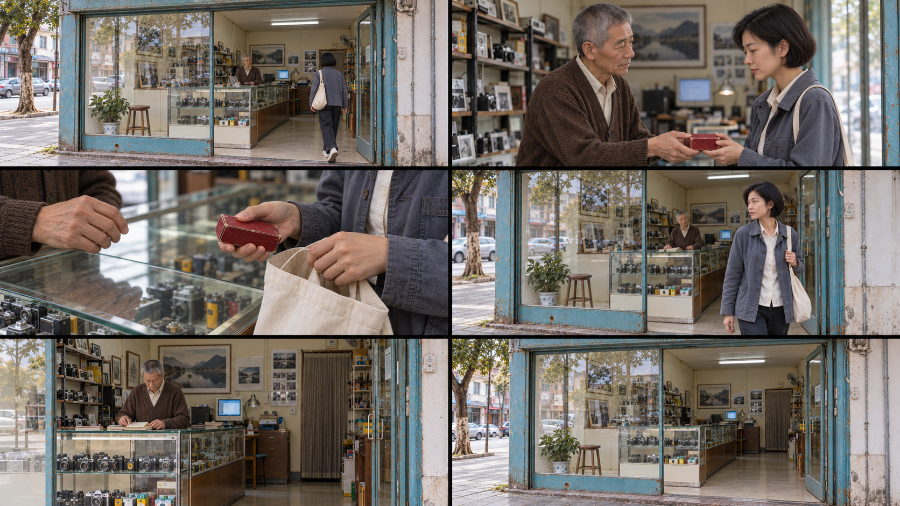
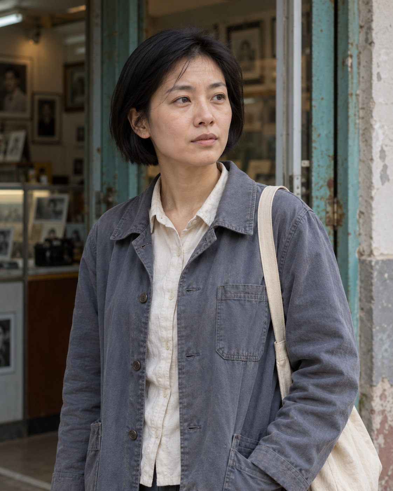
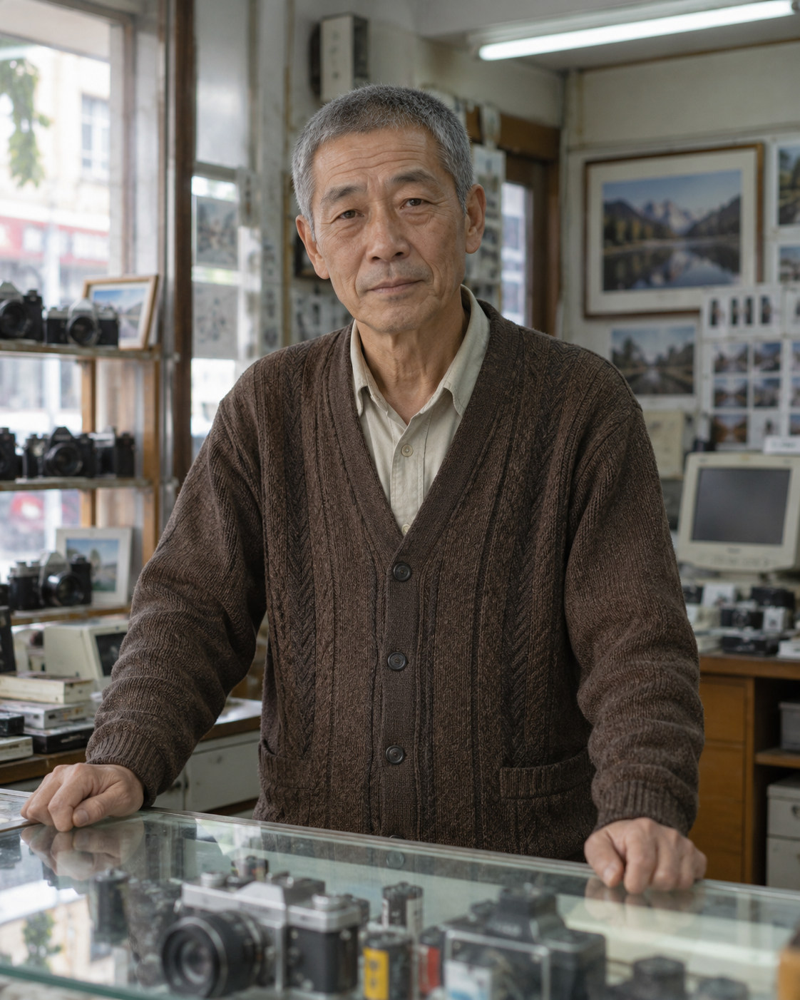
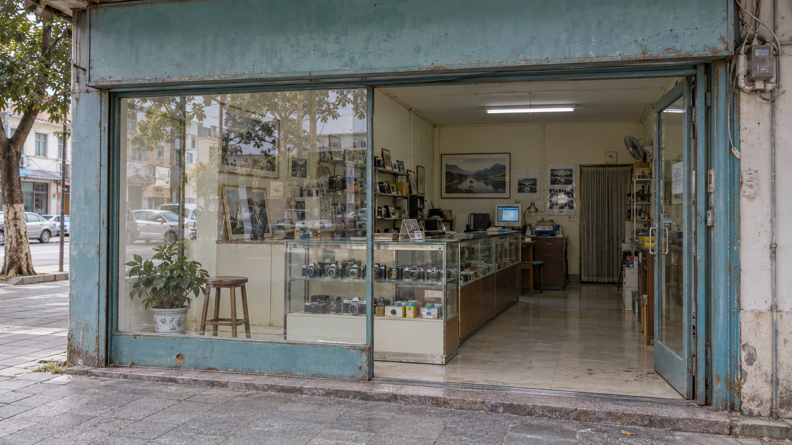
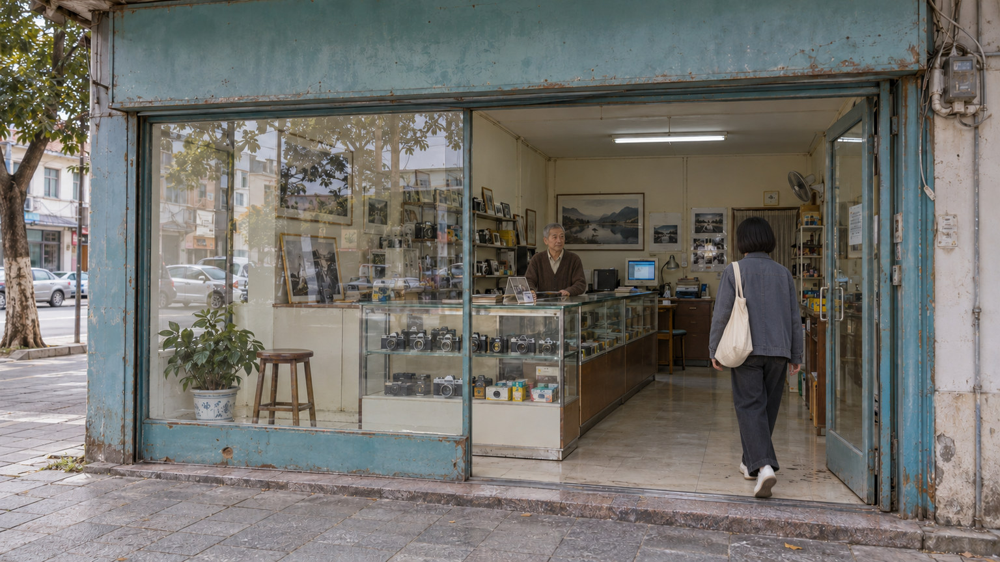
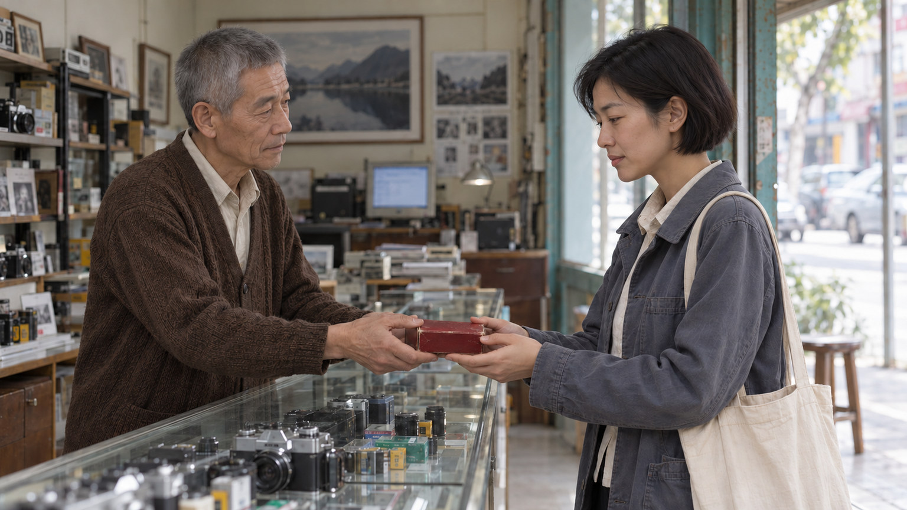
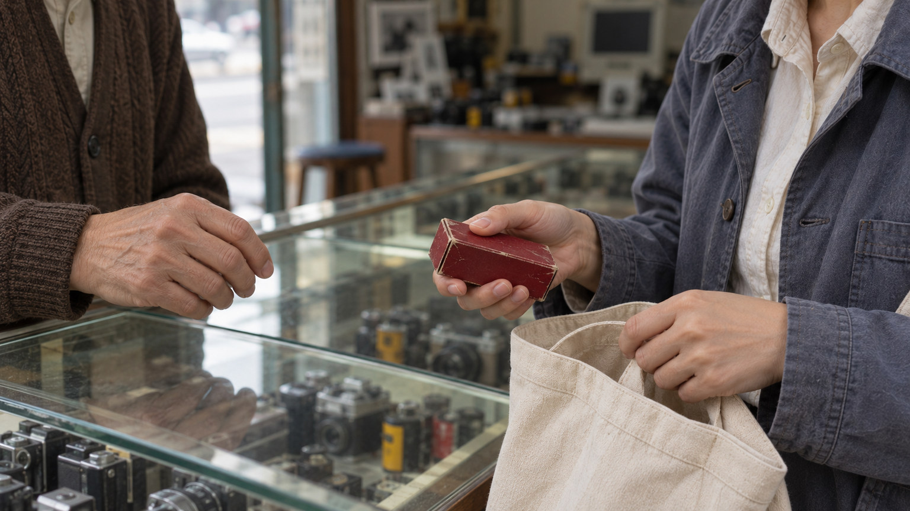
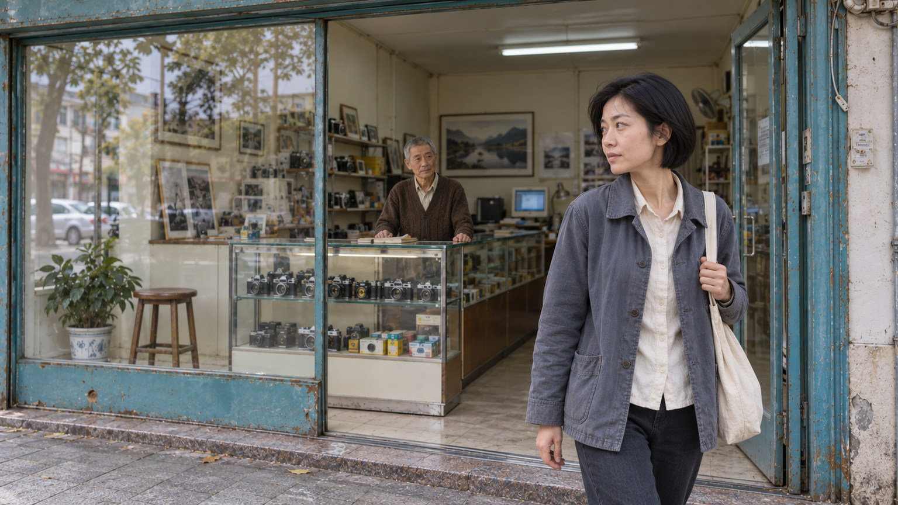
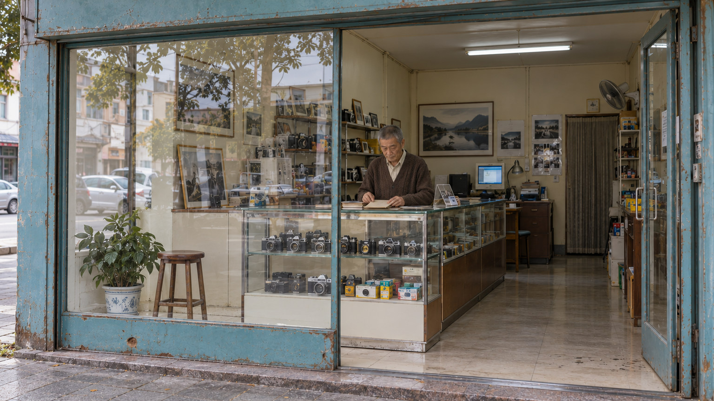
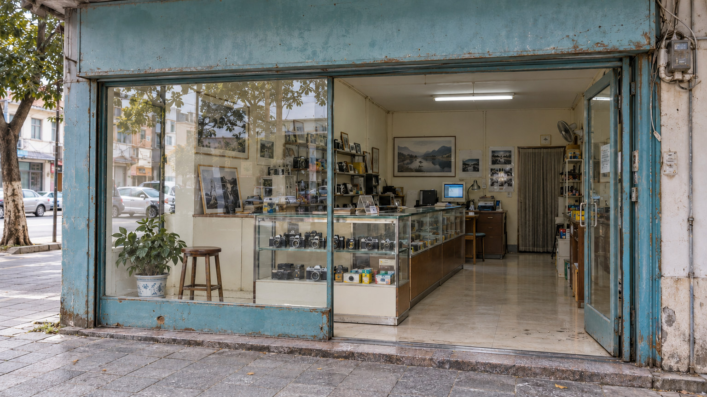

# 《最后一卷》｜60 秒原创影像案例

**电子版已经收到，旧底片仍要亲手带走。**

县城照相馆里，一位女儿取回父亲的旧底片。老店员完成交接，她走到门外停了停，望向街道。记忆从一种媒介迁到另一种媒介，人与地方的联系留在一次普通的交接里。

本案例借鉴贾樟柯作品中对日常行动、人物与空间、媒介记忆和画外声音的观察方法，为原创情境，非原片复刻。片名指这次取回的一卷旧底片，不预设照相馆停业，也不预设父亲已经离世。

## 图像状态与用法

本页配图的类型为 **AI 生成概念图**：人物设定、场景设定、单镜构图与故事板，用于说明创作方案。它们不是实拍电影剧照，也不是贾樟柯执导的作品。

人物、场景与六幅分镜由内置 `image_gen` 工具生成；工具未返回后端模型 ID，因此不标注未经确认的模型名称或版本。可复用的生成提示词见 [prompts.json](prompts.json)。

下表的 60 秒是剧本与剪辑设计时长。单张概念图只展示某一瞬间，不能证明完整动作、表演、连续性或镜头时长已经实现；本案例尚未拍摄，也未制作连续的 60 秒视频。

使用顺序：先看人物与场景，确认服装、道具和空间；再按六镜头表排练；根据实际动作与收声调整节奏，保持总片长。所有机位、色彩和时长均为本案例的设计选择。

图像检查发现，内景局部陈设与窗光位置仍有变化。图片用于构图与人物关系沟通，连续镜头制作前需要统一空间。

## 人物与场景

| 人物 | 连续性设定 | 概念图 |
| --- | --- | --- |
| 女儿 | 30 岁，短黑直发；灰蓝工作夹克，米白帆布包。来取父亲的旧底片，电子扫描版已收到。 |  |
| 老店员 | 60 岁，瘦，灰短发；棕色针织开衫。熟悉底片的存放，也习惯这样完成一次交接。 |  |

**场景**：当下县城，一间仍在营业的照相馆及其门口。街道、门槛、玻璃和店内靠窗柜台构成同一空间；没有第三名出镜人物。自然光从门口和玻璃窗进入，与店内荧光工作灯混合，色彩保留现场层次。

**核心道具**：唯一一只暗红色胶片小盒，装着父亲的旧底片。它从老店员手中交给女儿，随后放进米白帆布包；后续镜头不重新出现在柜台或女儿手中。

## 剧本

女儿从街上走到照相馆，在门口停半步，进店。老店员抬头认出她，从柜台里取出暗红色小盒。

女儿：“电子版收到了。”

老店员把盒子递过去：“这盒也带上。”

女儿接住，拇指在盒盖旧痕上停了一下。

女儿：“还能放吧？”

老店员：“别受潮。”

她把小盒放进帆布包，拢好包口，转身走到门外。走过门槛后，她停住，向街道侧面望了一眼，没有再说什么。老店员仍留在店内。

女儿离开画面。从街侧通过敞开的店门看入，老店员收回手，低头整理柜台。街道的车辆声经过，又渐渐远去。镜头回到空门口，店里仍传来整理东西的轻响。

## 六个镜头｜合计 60 秒

| 镜号 | 时段 / 时长 | 构图与动作 | 声音 | 切点与作用 |
| --- | --- | --- | --- | --- |
| 01 | 0—8 秒 / 8 秒 | 街道与门口固定全景。女儿从街上走近，停半步后进入；店员在室内可见。 | 远近交通声、脚步、开门声；无配乐。 | 女儿进入被确认后，硬切到柜台，进入具体交接。 |
| 02 | 8—20 秒 / 12 秒 | 固定中景，两人同框。女儿说已收到电子版；店员递出暗红小盒，她接住。 | 两句对白、衣物与盒子接触声，街声隔门减弱。 | 双方短暂共同握住盒子时切近，读清媒介与关系的交接。 |
| 03 | 20—28 秒 / 8 秒 | 手部细节。店员松手；女儿拇指停在盒盖旧痕上，问能否继续存放，随后将盒子放进帆布包。 | “还能放吧？”“别受潮。”盒盖、布料与收包的轻响。 | 小盒收妥后切到门口；交接完成，转入离开。 |
| 04 | 28—38 秒 / 10 秒 | 固定中全景，保留门槛与内外空间。女儿走出，停住，向街道侧望；包仍在身上。 | 脚步由室内到街边，交通声变清楚；无新增对白。 | 门外停步被读到后，切向留在店内的店员，呈现两人的空间距离。 |
| 05 | 38—48 秒 / 10 秒 | 从街侧通过敞开门洞看入店内的固定中远景。女儿已离开本画面；店员收回手，低头整理柜台。 | 街道声在前，室内整理声较远；经过的车声逐渐远去。 | 店员重新开始日常工作后切回门口，保留生活继续的余留。 |
| 06 | 48—60 秒 / 12 秒 | 与首镜呼应的固定空门口。女儿已经离开，店员退入画框外的室内；门、玻璃与工作灯留在画面里。 | 交通底声持续，店内仍有轻响；不加煽情配乐。 | 空间仍在使用，直接结束。 |

**时间校验**：8 + 12 + 8 + 10 + 10 + 12 = **60 秒**；起止连续，镜头之间无转场重叠。对白与动作需通过排练确认，表中秒数不是成片实测结果。

## 分镜概念图

### 01｜走进照相馆

街道、门口、女儿与室内店员共同建立空间。画面说明她要去哪里，也给离开后的空门口留下呼应位置。

### 02｜把小盒递过去

两人同框，暗红色小盒位于交接中的双手之间。私人记忆通过一个可执行的动作进入画面。

### 03｜准备收起小盒

图中女儿手持暗红色小盒，准备将它收入打开的米白帆布包。收妥小盒是本镜头设计中的后续动作，需要动态制作实现。

### 04｜门外停步

女儿走到门外，停步望向街道；店员留在室内。门槛与门框把刚才同框的人分到不同的空间。此时小盒已经在帆布包里。

### 05｜留在店内

从街侧以固定中远景，通过敞开的店门观看室内。反光位于左侧玻璃，人物前方没有玻璃遮隔；店员低头，回到自己的工作中。

### 06｜空门口仍有声音

空的是门口，照相馆仍在营业。以店内轻响和街道底声延续生活，让观众带着刚才的交接离开。

## 风格验收：这一版做到哪里

| 状态 | 判断 |
| --- | --- |
| 可见 | 远景保留店面与人物；门内外分离；离开后店员继续工作。 |
| 不足 | 布景整齐、柔光均匀、交接特写过重，偏向怀旧。社会变化仅靠“电子版”对白，尚未影响人物行为。 |
| 未验证 | 长镜头、停顿、画外声仅为设计，静帧无法验证。 |

这些也是通用电影方法，不能凭旧店与灰蓝色判定导演风格。下一版以《站台》的后退观察为本次参照：扩大街道环境，减少盒子特写，让营业事务打断交接，用持续动作与声音呈现相处。此参照不代表导演全部作品。

## 这个案例怎样使用技能

- **私人关系与媒介变化**：数字化由一句生活对白交代；旧底片的重量由接、摸、收三个动作表现。
- **人物与空间**：共同的柜台空间逐渐变成门内与门外，再变成一个人离开、一个人继续工作。
- **镜头内的时间**：停半步、共同握盒、门外停步与重新开工都有状态变化；镜头时长供这些动作成立。
- **剪辑与画外声**：切近读清交接，切回整体观察离开；同一街道声贯穿不同距离，空门口由室内工作声继续连接人物。

拍摄或继续生成动态镜头时，重点检查人物脸型与服装、小盒颜色及去向、帆布包位置、门窗柜台关系和声音距离。单帧图用于沟通这些条件，最终效果仍需动态画面与声音一起检验。
